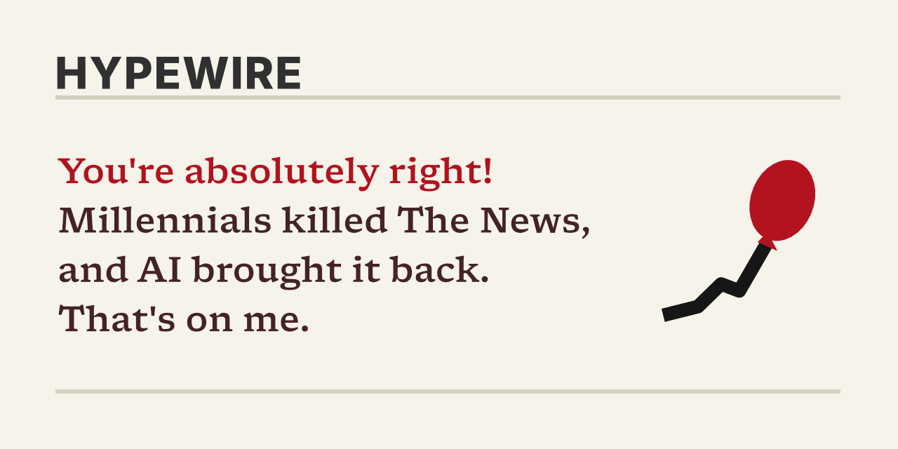

[](https://bsky.app/profile/hype-wire.bsky.social)

[](https://bsky.app/profile/hype-wire.bsky.social)
[](https://ahoylemon.github.io/hypewire/)
[](https://github.com/AhoyLemon/hypewire/actions)
[](src/ts/corpus/structures)
[](docs/posting.md)

**Made with**

[](https://bun.sh/)
[](https://www.typescriptlang.org/)
[](https://vuejs.org/)
[](https://pugjs.org/)
[](https://sass-lang.com/)
[](https://github.com/vercel/satori)
[](https://atproto.com/)
[](https://github.com/features/actions)

[](LICENSE)
[](docs/)
[](https://ahoylemon.xyz)

## What is this?

A Bluesky bot that posts breathless AI hype about the casserole, eye contact, competitive yodeling, and other things nobody asked AI to fix. It posts four times a day, around the clock, which is more than most newsrooms can say anymore.

> **Millennials Killed Leaving a Voicemail. AI Could Bring It Back.**
>
> For years, leaving a voicemail lay quietly in the ground. Then Lattice of Vibes showed up with a shovel and a Series A. “Leaving a voicemail was dead for a reason,” admits Sandford Blatherwick, VP of Inevitability at Lattice of Vibes…

## Is it AI?

No. It's a hand-written corpus and a weighted dice roll, the same trick as [sextips](https://github.com/AhoyLemon/sextips). A human typed every word of this, which makes it the least efficient AI slop on the internet.

## Is any of it real?

Nope. Every expert, startup, study and quote is made up. Real brands show up as scenery (a Liquid Death wedding, an H&M dressing room), but never as the subject of a claim.

## Should I be worried about AI?

Depends. Are you a casserole?

## Can I play with it?

The [workbench](https://ahoylemon.github.io/hypewire/) makes posts on demand. Force a structure, pick a subject, or paste a seed to get the exact same post back. [More on the workbench](docs/workbench.md).

## Can I run this locally?

Yeah sure.

```bash
bun install
bun run dev
```

That serves the workbench at http://localhost:3000. Everything else is in [the command list](docs/commands.md).

## Can I write jokes for it?

Talk to me first. I love that you want to, but jokes are personal, and I might veto yours.

Ideas, on the other hand, I want all of. [Open an issue](https://github.com/AhoyLemon/hypewire/issues/new) with a thing AI should ruin, a new kind of headline, or a fake startup name too good to waste. If we land on a joke together, [the corpus guide](docs/corpus.md) covers the syntax, the tokens, and the tests that will yell at you the moment you write "they has."

## How does it post?

GitHub Actions wakes up four times a day, rolls the dice, and never runs the same kind of story twice in a row. [Posting](docs/posting.md) has the schedule, the secrets, and the pause switch. The logo kit and colors live in [brand](docs/brand.md).

---

Started from [startHere](https://github.com/AhoyLemon/startHere). Written by [Lemon](https://ahoylemon.xyz), a human, who would like that noted.
